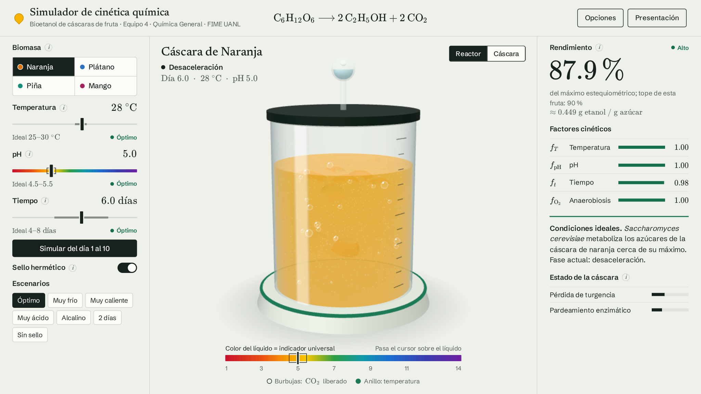
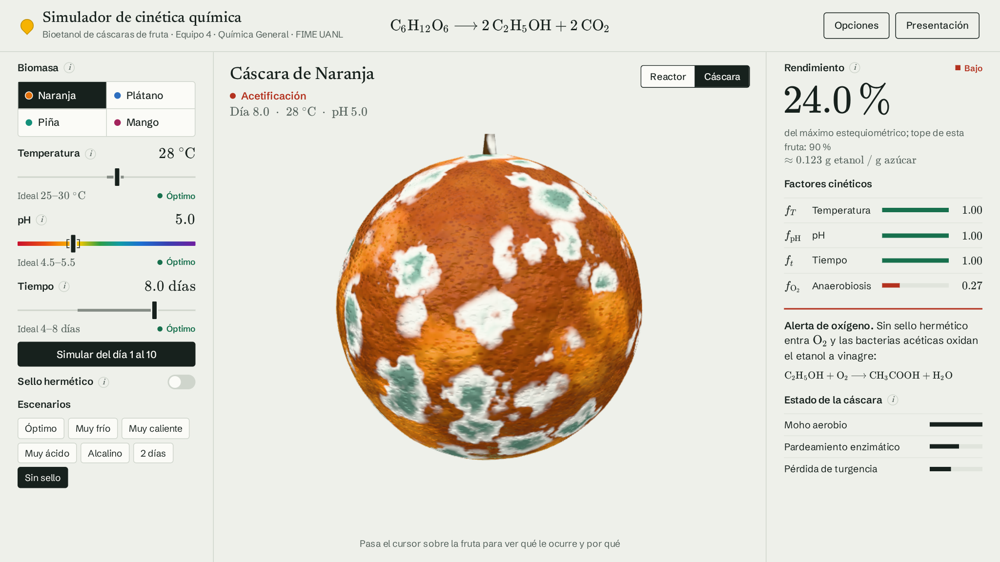

# Simulador de cinética química · Bioetanol

Simulador interactivo que muestra cómo la levadura convierte el azúcar de las cáscaras de fruta en **bioetanol**, un alcohol que sirve como combustible. Cambias la temperatura, el pH, el tiempo y el sellado del recipiente, y ves al instante cuánto etanol se obtendría y qué le pasa al reactor y a la cáscara.

**[Abrir el simulador](https://lodraw.github.io/simulado-cinetica-quimica/)**

Proyecto de Química General del Equipo 4, FIME UANL.



> **Importante:** es un modelo didáctico. Representa tendencias reportadas en la literatura, no datos medidos en un laboratorio. La sección [Alcance y limitaciones](#alcance-y-limitaciones) detalla qué está calculado y qué es ilustrativo.

## La idea en un minuto

Las cáscaras de fruta suelen desecharse, pero contienen azúcares y carbohidratos aprovechables. La levadura *Saccharomyces cerevisiae* fermenta esos azúcares sin oxígeno y produce etanol y dióxido de carbono:

**C₆H₁₂O₆ → 2 C₂H₅OH + 2 CO₂**

La levadura es un ser vivo y solo trabaja bien en ciertas condiciones. Si hace demasiado frío o calor, si el medio es muy ácido o alcalino, si falta tiempo o si entra oxígeno, se obtiene menos etanol. El simulador permite explorar esas condiciones sin gastar material ni esperar días.

Compara cuatro cáscaras: **naranja, plátano, piña y mango**.

## Cómo abrirlo

- **En línea:** usa el enlace de arriba. Funciona en un navegador actual con WebGL, y la primera carga puede tardar un momento.
- **Sin internet:** abre `dist/index.html` con doble clic. Todo está en ese único archivo.

Se recomienda usar una computadora. En un teléfono funciona con menos detalle visual, y las explicaciones que aparecen al pasar el cursor sobre el 3D no están disponibles.

## Recorrido de cinco minutos

1. **Parte de las condiciones óptimas.** Al abrir, la naranja está a 28 °C, pH 5.0, día 6 y con sello: el rendimiento es 87.9 %.
2. **Cambia la temperatura.** Pulsa el escenario **Muy caliente** (42 °C). El rendimiento cae a 0.2 % y casi desaparecen las burbujas.
3. **Compara las frutas.** Pulsa **Muy ácido** (pH 2.5) y observa la gráfica «Entre frutas»: la piña es la que mejor tolera la acidez (53.5 %).
4. **Quita el sello.** Pulsa **Sin sello**. La tapa se levanta, la fase cambia a acetificación y el rendimiento baja a 24.0 %.
5. **Mira la cáscara.** Con ese mismo escenario, cambia a la vista **Cáscara** y pasa el cursor sobre la fruta para leer qué le ocurre y por qué.
6. **Observa el tiempo.** Pulsa **Simular del día 1 al 10**. En unos 10 segundos se recorre la fermentación y la curva avanza en la gráfica.



## Funciones

### Controles (panel izquierdo)

| Control | Rango | Zona ideal | Qué representa |
|---|---|---|---|
| **Biomasa** | 4 cáscaras | — | Cada fruta tiene su propio tope de rendimiento, velocidad y tolerancia |
| **Temperatura** | 0–50 °C | 25–30 °C | Temperatura del fermentador |
| **pH** | 1–14 | 4.5–5.5 | Acidez del medio |
| **Tiempo** | 1–10 días | 4–8 días | Días de fermentación |
| **Sello hermético** | Sí / No | Sí | Si el recipiente impide la entrada de oxígeno |

- **Simular del día 1 al 10:** anima la fermentación completa.
- **Escenarios:** siete combinaciones listas para comparar.
- **Botones «i»:** al pasar el cursor explican el fundamento químico de cada control.

### Biorreactor 3D (centro)

La vista **Reactor** traduce los resultados a lo que se observa:

| Lo que ves | Lo que significa |
|---|---|
| Color del líquido | pH, como si el medio tuviera indicador universal. El mosto real no se tiñe solo |
| Burbujas, espuma y trampa de agua | Actividad de la levadura y liberación de CO₂ |
| Partículas y turbidez | Levadura en suspensión. Si no crece, el medio sigue claro |
| Color del anillo | Temperatura: azul por debajo de 25 °C, verde de 25 a 30 °C, naranja a rojo por encima de 30 °C |
| Tapa levantada y velo en la superficie | Falta de sello: entra oxígeno |

Al pasar el cursor sobre el líquido aparecen el significado del color, la concentración de H₃O⁺, el factor de pH y la turbidez. Se puede girar la escena arrastrando con el ratón.

La vista **Cáscara** muestra la fruta entera y su deterioro:

| Efecto | Cuándo aparece |
|---|---|
| Pardeamiento enzimático | Avanza con el tiempo y la temperatura (Q₁₀ ≈ 2). Es menor con sello y depende de la fruta |
| Escaldado | Empieza a 34 °C y llega a su máximo a 48 °C |
| Decoloración ácida | pH menor que 4.2 |
| Oxidación alcalina | pH mayor que 7 |
| Moho aerobio | Solo sin sello y a partir del día 2. Se inhibe con temperatura o pH extremos |
| Pérdida de turgencia | Acompaña al desgaste, al calor y a los pH extremos |

Este deterioro es cualitativo y **no modifica el rendimiento**.

### Resultados (panel derecho)

- **Rendimiento:** porcentaje del máximo estequiométrico y su equivalente en gramos de etanol por gramo de azúcar. Se califica como alto (70 % o más), medio (40 % o más) o bajo.
- **Factores cinéticos:** cuatro barras de 0 a 1 que muestran qué condición limita el resultado.
- **Diagnóstico:** explica en una frase el factor que más limita.
- **Estado de la cáscara:** intensidad de los efectos visibles.
- **Fase:** latencia, exponencial, desaceleración, estacionaria o acetificación (arriba del reactor).

### Gráficas

- **Entre frutas:** compara las cuatro cáscaras en las condiciones actuales. El contorno marca el tope de cada fruta en condiciones ideales.
- **En el tiempo:** muestra el rendimiento de cada fruta del día 1 al 10. El punto indica el día actual.

### Secciones avanzadas (botón Opciones)

Empiezan ocultas para no saturar la pantalla:

- **El modelo:** muestra las ecuaciones con los valores actuales sustituidos en vivo.
- **Etapas del proceso:** recorre acondicionado, pretratamiento, hidrólisis, fermentación, destilación y combustión, con sus reacciones. Solo la fermentación se simula.
- **Calculadora estequiométrica:** convierte una masa de azúcar en moles, gramos y mililitros de etanol y en gramos y litros de CO₂, paso a paso.

El botón **Presentación** agranda el texto y activa la pantalla completa para el proyector.

## Cómo se calcula

El simulador usa un **modelo semi-empírico**: multiplica el tope de cada fruta por cuatro factores entre 0 y 1. Si todos valen 1, se alcanza el tope; si uno vale 0, no hay producción.

```math
R = \eta \cdot f_T \cdot f_{\mathrm{pH}} \cdot f_t \cdot f_{\mathrm{O_2}}
```

$R$ es el rendimiento y $\eta$ es la eficiencia de la fruta. El **100 % equivale al máximo estequiométrico**: 1 mol de glucosa da 2 mol de etanol.

```math
Y_{\max} = \frac{2\,(46.07)}{180.16} = 0.5114\ \text{g de etanol por g de glucosa}
```

### Parámetros por fruta

| Fruta | Eficiencia $\eta$ (%) | Sensibilidad térmica $s$ | Resistencia ácida $r$ | Velocidad $v$ | Fermentación completa $t_F$ (días) |
|---|---:|---:|---:|---:|---:|
| Naranja | 90 | 1.0 | 1.0 | 1.00 | 8.00 |
| Plátano | 85 | 1.2 | 0.8 | 0.85 | 9.41 |
| Piña | 80 | 0.9 | 1.4 | 1.20 | 6.67 |
| Mango | 75 | 1.1 | 0.9 | 0.95 | 8.42 |

Estos valores son **ilustrativos**, no experimentales.

### Temperatura

Vale 1 entre 25 y 30 °C. Fuera de ese rango cae como una gaussiana, y lo hace más rápido con calor (desnaturalización) que con frío (reacciones más lentas):

```math
f_T =
\begin{cases}
\exp\!\left[-\dfrac{(25-T)^2}{2\,(6/s)^2}\right] & T < 25 \\[8pt]
1 & 25 \le T \le 30 \\[8pt]
\exp\!\left[-\dfrac{(T-30)^2}{2\,(3.5/s)^2}\right] & T > 30
\end{cases}
```

### pH

Vale 1 entre 4.5 y 5.5. Fuera de ese rango también cae como una gaussiana. Un valor de $r$ mayor que 1 suaviza la caída del lado ácido y la acentúa del lado alcalino:

```math
f_{\mathrm{pH}} = \exp\!\left[-\frac{d^2}{2\,(1.6)^2}\right],
\qquad
d =
\begin{cases}
(4.5-\mathrm{pH})/r & \mathrm{pH} < 4.5 \\
0 & 4.5 \le \mathrm{pH} \le 5.5 \\
r\,(\mathrm{pH}-5.5) & \mathrm{pH} > 5.5
\end{cases}
```

### Tiempo

La producción sigue una curva logística, normalizada para valer 1 al completarse la fermentación en $t_F = 8/v$:

```math
f_t = \min\!\left(1,\ \frac{L(t)}{L(t_F)}\right),
\qquad
L(t) = \frac{1}{1 + e^{-1.3\,(v\,t - 3.2)}}
```

La fase mostrada depende de $L(t)$: latencia por debajo de 0.15, exponencial hasta 0.85 y desaceleración después. A partir de $t_F$ la fase es estacionaria.

### Oxígeno

Sin sello, las bacterias acéticas (*Acetobacter*) oxidan el etanol a ácido acético: **C₂H₅OH + O₂ → CH₃COOH + H₂O**. La pérdida empieza en el día 2, y después del día 3 la fase se muestra como acetificación:

```math
f_{\mathrm{O_2}} =
\begin{cases}
1 & \text{con sello} \\
e^{-0.22\,\max(0,\ t-2)} & \text{sin sello}
\end{cases}
```

### Ejemplo completo

Naranja a 28 °C, pH 5.0, día 6 y con sello:

```math
R = 90 \times 1.000 \times 1.000 \times 0.976 \times 1.000 = 87.9\,\%
```

Con 100 g de glucosa, la calculadora da:

| Paso | Resultado |
|---|---|
| Glucosa: 100 g ÷ 180.16 g/mol | 0.555 mol |
| Etanol: 2 × 0.555 × 0.879 | 0.975 mol |
| Masa de etanol: 0.975 mol × 46.07 g/mol | 44.9 g |
| Volumen de etanol: 44.9 g ÷ 0.789 g/mL | 57.0 mL |
| CO₂: 0.975 mol × 44.01 g/mol | 42.9 g |
| Volumen de CO₂: 0.975 mol × 24.47 L/mol (25 °C, 1 atm) | 23.9 L |

Con sello, el etanol y el CO₂ tienen los mismos moles. Sin sello son distintos: la acetificación consume etanol, pero no retira el CO₂ ya liberado. Por eso el etanol usa $R$ y el CO₂ usa el rendimiento de la fermentación, $R / f_{\mathrm{O_2}}$.

### Resultados de los escenarios

Rendimiento en porcentaje del máximo estequiométrico:

| Escenario | Condiciones | Naranja | Plátano | Piña | Mango |
|---|---|---:|---:|---:|---:|
| Óptimo | 28 °C, pH 5.0, día 6, con sello | 87.9 | 78.5 | 79.7 | 72.3 |
| Muy frío | 12 °C, pH 5.0, día 6, con sello | 8.4 | 2.7 | 11.9 | 4.2 |
| Muy caliente | 42 °C, pH 5.0, día 6, con sello | 0.2 | 0.0 | 0.7 | 0.1 |
| Muy ácido | 28 °C, pH 2.5, día 6, con sello | 40.2 | 23.2 | 53.5 | 27.6 |
| Alcalino | 28 °C, pH 8.5, día 6, con sello | 15.2 | 25.5 | 2.5 | 17.4 |
| 2 días | 28 °C, pH 5.0, día 2, con sello | 15.7 | 10.6 | 20.9 | 11.7 |
| Sin sello | 28 °C, pH 5.0, día 8, sin sello | 24.0 | 22.5 | 21.4 | 20.0 |

## Alcance y limitaciones

**Sustentado en química y física:**

- La estequiometría de las reacciones, las masas molares, $Y_{\max}$, la densidad del etanol (0.789 g/mL) y el volumen molar del gas (24.47 L/mol a 25 °C y 1 atm).
- Las tendencias cualitativas: rangos óptimos de la levadura, forma logística de la producción y acetificación en presencia de oxígeno.

**Ilustrativo, no medido:**

- Las eficiencias por fruta, las constantes de las curvas, el deterioro de la cáscara, la turbidez y la intensidad de las burbujas.
- Se basan en tendencias reportadas por Linares-Luna et al. (2022), Mendoza-Espinoza et al. (2022) y Carvajal (2021), no en experimentos propios.

**Simplificaciones del modelo:**

- **No es un modelo cinético mecanístico.** No resuelve ecuaciones diferenciales ni usa constantes de velocidad, Arrhenius o Monod. Sus factores son curvas de respuesta.
- **La temperatura y el pH escalan el rendimiento, pero no desplazan la curva en el tiempo.** A 12 °C la fermentación termina el mismo día que a 28 °C, solo que con menos etanol. En la realidad el frío también la retrasaría.
- **Las condiciones son constantes.** El pH no baja por la propia fermentación y la temperatura no cambia durante el proceso.
- **No hay balance de sustrato ni inhibición cuantitativa.** No se modelan el agotamiento de azúcares, la inhibición por etanol ni el efecto del D-limoneno. Solo se mencionan en los textos.
- **El rendimiento no depende de la masa inicial de azúcar.** La calculadora considera que toda la masa ingresada es glucosa equivalente fermentable.
- **Sin sello solo se modela la acetificación.** No se representa el cambio de la levadura hacia la respiración aerobia.
- **El volumen de CO₂ siempre se calcula a 25 °C y 1 atm.** No depende de la temperatura elegida ni considera el gas disuelto.

## Glosario

| Término | Significado |
|---|---|
| **Acetificación** | Conversión del etanol en ácido acético por bacterias, en presencia de oxígeno |
| **Anaerobiosis** | Condición sin oxígeno, necesaria para esta fermentación |
| **Bioetanol** | Etanol obtenido de biomasa, como residuos vegetales |
| **Biomasa** | Materia orgánica usada como materia prima; aquí, las cáscaras |
| **Máximo estequiométrico** | Mayor cantidad de producto que permite la ecuación química balanceada |
| **Mosto** | Mezcla líquida que se fermenta |
| **Rendimiento** | Etanol obtenido, como porcentaje del máximo estequiométrico |
| **Semi-empírico** | Modelo que usa ecuaciones elegidas para reproducir tendencias, sin deducir cada paso del mecanismo |

## Para desarrolladores

Está hecho con JavaScript sin framework, Vite, Three.js, Chart.js y KaTeX. Requiere Node.js.

```bash
npm install
npm run dev      # desarrollo en http://localhost:5173
npm run build    # genera dist/index.html, un solo archivo que funciona sin internet
```

| Archivo | Función |
|---|---|
| `src/modelo.js` | Modelo químico: funciones puras, sin interfaz. Todo cambio al modelo va aquí |
| `src/main.js` | Interfaz: controles, resultados, gráficas, ecuaciones y calculadora |
| `src/reactor3d.js` | Escena 3D, texturas y deterioro visual |
| `src/tex.js` | Fórmulas con KaTeX |
| `src/style.css` | Estilos |
| `.github/workflows/deploy.yml` | Publicación en GitHub Pages en cada push a `main` |
